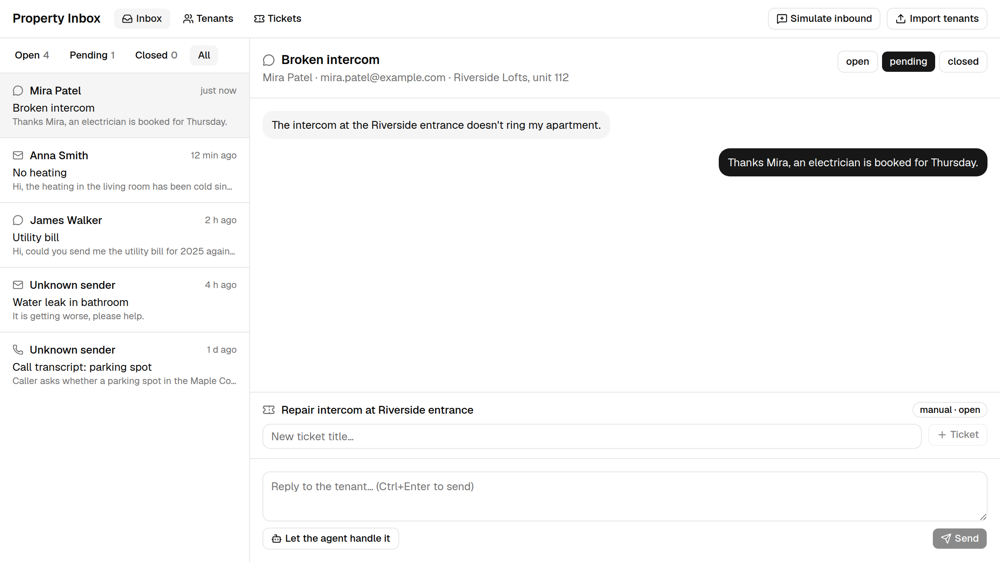
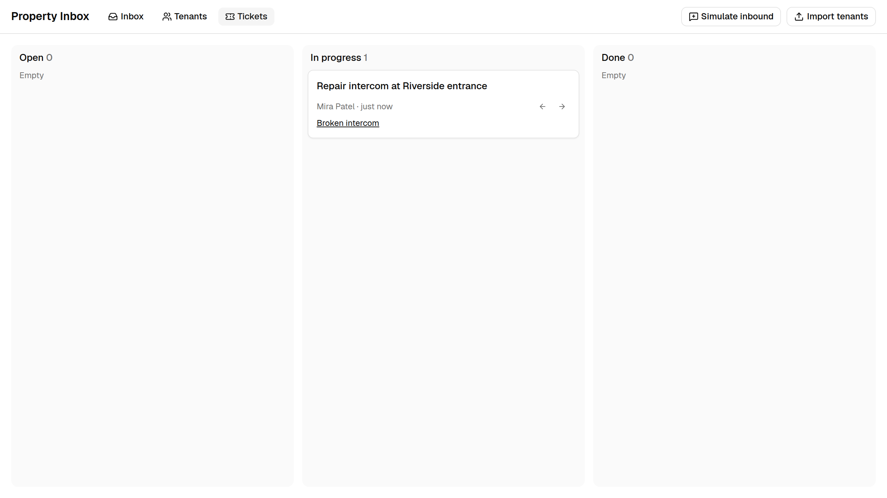
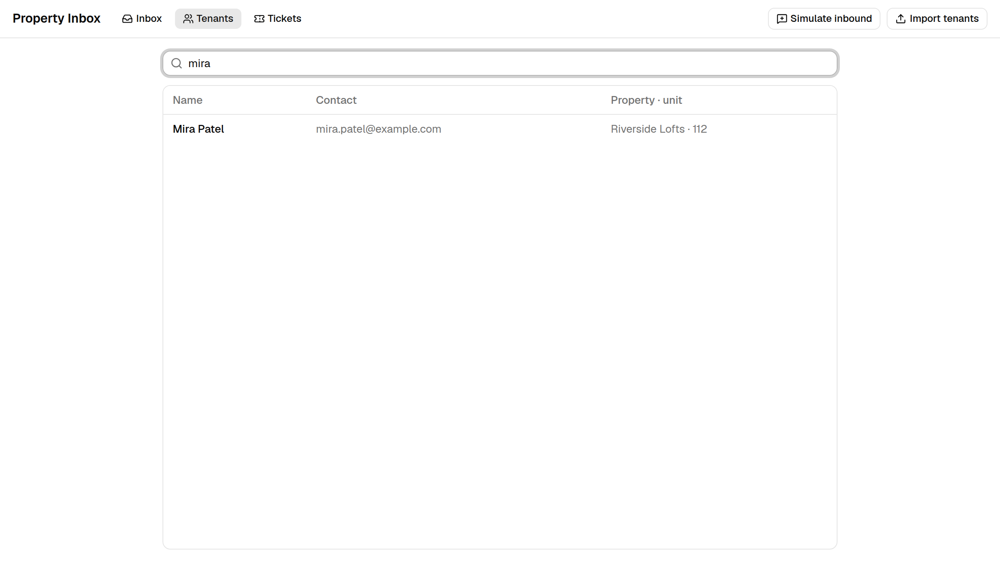
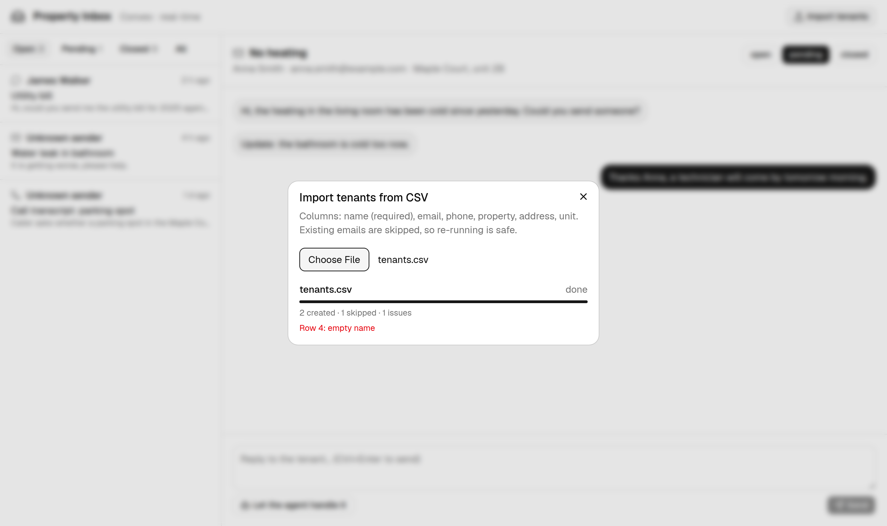

# Property Inbox — Convex

A real-time inbox for a property management company, built on [Convex](https://convex.dev).
Tenant messages from email, WhatsApp and phone land in one live list; managers reply, open tickets and track them on a board;
tenants are imported from CSV; an AI agent can take a conversation, identify the tenant, open a ticket and draft a reply.

**Stack:** TypeScript end to end · Convex (database, queries/mutations/actions, file storage, scheduler, HTTP actions, search) ·
React 19 · Vite · Tailwind 4 · shadcn/ui · OpenRouter · Vitest + convex-test



## Features

| Feature | How it's built | Code |
|---|---|---|
| **Live inbox** — status tabs with counts, threads, replies | reactive queries over indexes; replies use an **optimistic update**, so they appear instantly | `convex/conversations.ts`, `src/components/Thread.tsx` |
| **Inbound messages** from email / WhatsApp / phone | **HTTP action** `POST /inbound` (bearer secret) and a "Simulate inbound" dialog share one code path: match sender to tenant by email, append to their latest open thread on that channel or start a new one | `convex/http.ts`, `convex/inbound.ts` |
| **Tickets board** — open → in progress → done | tickets created by managers from a thread or by the agent | `convex/tickets.ts`, `src/components/TicketsView.tsx` |
| **Tenant directory** | **paginated** query with **full-text search** | `convex/tenants.ts`, `src/components/TenantsView.tsx` |
| **CSV import** with live progress | upload to **file storage** → **scheduled action** parses the file → **internal mutations** insert batches of 200; progress is a reactive query | `convex/imports.ts`, `convex/lib/csv.ts` |
| **AI agent** | action calling OpenRouter with tools `find_tenant`, `link_tenant`, `create_ticket`, `set_status`; each step is saved and shown live; the final answer becomes an *AI draft* | `convex/agent.ts` |



### Design notes
- **Import is safe to retry.** One transaction per batch, so a failure keeps finished batches; tenants are de-duplicated by email.
  Properties and units are created on first sight. Headers are matched case-insensitively with aliases (`tenant`, `apartment`,
  `building`, `e-mail`…), `,` or `;` delimiters, quoted fields.
- **Agent is defensive.** It runs in the background; tool errors (bad id, unknown status) are returned to the model instead of
  failing the run; the tenant's messages are passed as data, not instructions; the run stops after 6 turns.
- **Threading.** A message from a known tenant goes to their latest thread on the same channel unless it was closed —
  then it opens a new one, like a new support case.

 

## Run locally

```bash
npm install
npx convex dev          # log in, or pick a local deployment without an account
npm run dev             # http://localhost:5173 → "Load demo data"
```

Optional:

```bash
npx convex env set OPENROUTER_API_KEY sk-or-...          # enables the agent
npx convex env set OPENROUTER_MODEL google/gemini-2.5-flash
npx convex env set INBOUND_SECRET some-secret             # enables the webhook

curl -X POST "$VITE_CONVEX_SITE_URL/inbound" -H "authorization: Bearer some-secret" \
  -H "content-type: application/json" \
  -d '{"channel":"email","from":"anna.smith@example.com","subject":"No heating","body":"The bathroom is cold too now."}'
```

## Deploy

```bash
npx convex deploy                                # production backend
# Vercel: build command `npx convex deploy --cmd 'npm run build'`, env CONVEX_DEPLOY_KEY from the Convex dashboard
```

## Checks

```bash
npm test            # 13 tests with convex-test: import, threading, tickets, pagination/search, agent tool loop (OpenRouter mocked)
npm run typecheck
npm run lint
```
CI runs all of them on every push (`.github/workflows/ci.yml`).
